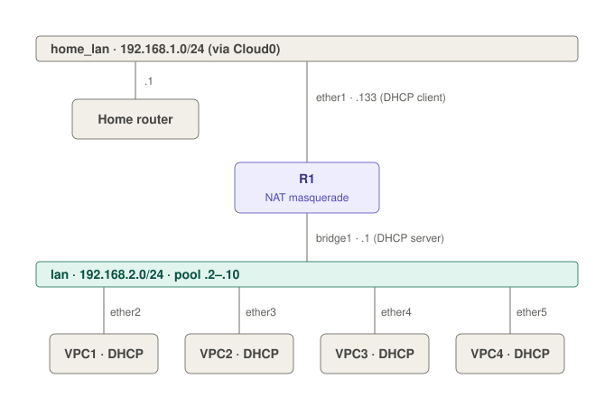

# Lab 1: DHCP Server, Bridge and NAT

> **Cert:** MTCNA modules 2 (DHCP), 3 (Bridging) and 6 (NAT) · **Status:** ✅ Tested in lab

[Labs index](README.md) · [Back to the main index](../README.md)

---

## Goal

One CHR router (R1) that:

- gets its WAN address from the home router on **ether1** (DHCP client),
- acts as a **switch** for four PCs on **ether2–ether5** (bridge),
- hands out IP addresses to those PCs (DHCP server),
- gives them internet access (NAT masquerade).

## Topology



<details><summary>Text version</summary>

```
Home router (192.168.1.1)
        │
   Cloud0 / pnet0  (home LAN 192.168.1.0/24)
        │
     ether1   WAN: 192.168.1.133/24 (DHCP client), NAT out
        R1
     bridge1  LAN: 192.168.2.1/24, DHCP server, pool .2–.10
      ├─ ether2 ── VPC1
      ├─ ether3 ── VPC2
      ├─ ether4 ── VPC3
      └─ ether5 ── VPC4
```

</details>

| Item | Value |
|---|---|
| Router | MikroTik CHR 7.24.5, 6 Ethernets |
| WAN | ether1 → Cloud0 (Management), DHCP client |
| LAN | bridge1 = ether2–ether5, `192.168.2.1/24` |
| DHCP pool | `192.168.2.2-192.168.2.10` (9 addresses) |
| Clients | 4 × VPCS, cabled straight to R1 (no EVE-NG switch needed) |

---

## Concept: the pieces and why each one is needed

| Piece | What it does | Without it |
|---|---|---|
| **Bridge** | Joins several ports into one L2 network: a switch inside the router | Each port is its own network and needs its own IP and DHCP server |
| **IP on the bridge** | R1's own address on the LAN; becomes the PCs' gateway | DHCP server has nothing to serve from |
| **Pool** | The range of addresses R1 may hand out | Server can only answer static leases (`static-only`) |
| **DHCP server** | Answers DHCP requests on one interface | PCs never get an IP |
| **DHCP network** | Mask, gateway and DNS sent along with the IP | PCs get an IP with `/0` and gateway `0.0.0.0`: LAN works, internet doesn't |
| **NAT masquerade** | Swaps the PC's `192.168.2.x` source for R1's WAN IP | Home router doesn't know `192.168.2.0/24`, so replies never come back |

**Pool vs. network:** the pool decides **which IP** a client gets. The network entry decides **mask, gateway and DNS**.

**Rule:** once ports join a bridge, every Layer-3 setting (IP address, DHCP server, DHCP client) goes on the **bridge**, never on the member ports. Member ports show the `S` (slave) flag.

---

## EVE-NG setup

1. Add **R1** (CHR). Stop it, then right-click → **Edit** → **Ethernets** `6`. A default CHR has only ether1–ether4.
2. Add a network: right-click canvas → **Add a new object** → **Network** → Type **Management(Cloud0)**.
3. Cable **R1 eth1 → Cloud0**.
4. Add 4 **VPCS** nodes. Cable each one **directly** to R1: VPC1 → eth2, VPC2 → eth3, VPC3 → eth4, VPC4 → eth5.
5. Start all nodes.

> ⚠️ Never run a DHCP server on a port connected to Cloud0. It would hand out addresses on your real home LAN.

---

## Config steps

### Step 1: WAN on ether1

CHR runs a DHCP client on ether1 by default. Check it is bound:

> 🖱️ **WinBox:** IP → DHCP Client → ether1 shows status **bound**
>
> ⌨️ **CLI:**
> ```
> /ip dhcp-client print
> ```

If it is missing: `/ip dhcp-client add interface=ether1 disabled=no`

### Step 2: Create the bridge and add the LAN ports

> 🖱️ **WinBox:** Bridge → **+** → Name `bridge1` → OK. **Ports** tab → **+** → Interface `ether2`, Bridge `bridge1`. Repeat for ether3, ether4, ether5.
>
> ⌨️ **CLI:**
> ```
> /interface bridge add name=bridge1
> /interface bridge port add bridge=bridge1 interface=ether2
> /interface bridge port add bridge=bridge1 interface=ether3
> /interface bridge port add bridge=bridge1 interface=ether4
> /interface bridge port add bridge=bridge1 interface=ether5
> ```

### Step 3: LAN IP on the bridge

Use a **different subnet** from the WAN (`192.168.1.0/24`).

> 🖱️ **WinBox:** IP → Addresses → **+** → Address `192.168.2.1/24`, Interface `bridge1` → OK
>
> ⌨️ **CLI:**
> ```
> /ip address add address=192.168.2.1/24 interface=bridge1
> ```

### Step 4: Address pool

A range uses a dash: `start-end`. A single IP makes a pool of one.

> 🖱️ **WinBox:** IP → Pool → **+** → Name `pool1`, Addresses `192.168.2.2-192.168.2.10` → OK
>
> ⌨️ **CLI:**
> ```
> /ip pool add name=pool1 ranges=192.168.2.2-192.168.2.10
> ```

### Step 5: DHCP server on the bridge

> 🖱️ **WinBox:** IP → DHCP Server → **+** → Name `server1`, Interface `bridge1`, Address Pool `pool1` → OK
>
> ⌨️ **CLI:**
> ```
> /ip dhcp-server add name=server1 interface=bridge1 address-pool=pool1 disabled=no
> ```

### Step 6: DHCP network (mask, gateway, DNS)

> 🖱️ **WinBox:** IP → DHCP Server → **Networks** tab → **+** → Address `192.168.2.0/24`, Gateway `192.168.2.1`, DNS Servers `8.8.8.8` → OK
>
> ⌨️ **CLI:**
> ```
> /ip dhcp-server network add address=192.168.2.0/24 gateway=192.168.2.1 dns-server=8.8.8.8
> ```

If DNS is left empty, R1 passes on its own DNS servers (here the home router `192.168.1.1`), which also works.

Steps 4–6 can also be done with the wizard: `/ip dhcp-server setup` or WinBox **DHCP Setup**.

### Step 7: NAT masquerade for internet

> 🖱️ **WinBox:** IP → Firewall → **NAT** → **+** → General: Chain `srcnat`, Out. Interface `ether1` → Action: `masquerade` → OK
>
> ⌨️ **CLI:**
> ```
> /ip firewall nat add chain=srcnat out-interface=ether1 action=masquerade
> ```

### Step 8: PCs request an IP

On every VPC:

```
ip dhcp
show ip
save
```

Expected: `IP/MASK 192.168.2.x/24`, `GATEWAY 192.168.2.1`.

If a VPC got its lease **before** the network entry existed, renew it:

```
clear ip
ip dhcp
```

### Save the router config

```
/export file=lab-dhcp-bridge-nat
```

---

## Verify

| Check | 🖱️ WinBox | ⌨️ CLI | Expected |
|---|---|---|---|
| LAN ports in bridge | Bridge → Ports | `/interface bridge port print` | ether2–ether5 in bridge1 |
| IP on the bridge | IP → Addresses | `/ip address print` | `192.168.2.1/24` on bridge1, `192.168.1.x` on ether1 |
| DHCP server valid | IP → DHCP Server | `/ip dhcp-server print` | server1 on bridge1, pool1, no `I` flag |
| Network entry | DHCP Server → Networks | `/ip dhcp-server network print` | `192.168.2.0/24`, gateway `192.168.2.1` |
| Leases | DHCP Server → Leases | `/ip dhcp-server lease print` | One lease per VPC |
| NAT working | IP → Firewall → NAT | `/ip firewall nat print stats` | Packet counter rises while pinging |
| Default route | IP → Routes | `/ip route print` | `0.0.0.0/0` via ether1 (`DAd`) |

From a VPC:

| Ping | Proves |
|---|---|
| `ping 192.168.2.x` (another VPC) | Bridge switches traffic between ports |
| `ping 192.168.2.1` | PC reaches R1 |
| `ping 192.168.1.1` | R1 routes to the home LAN |
| `ping 8.8.8.8` | NAT and internet work |
| `ping google.com` | DNS works |

Watch DHCP live while a VPC runs `ip dhcp`:

```
/log print follow where topics~"dhcp"
```

---

## Troubleshooting (real mistakes from this lab)

| Symptom | Cause | Fix |
|---|---|---|
| WebFig/WinBox to `192.168.1.133` hangs after configuring ether2 | ether2 set to `192.168.1.1/24`, same subnet as ether1. Replies to the PC go out the wrong port, and `.1` duplicates the home router | Each interface on its own subnet: `/ip address set [find interface=ether2] address=192.168.2.1/24` |
| DHCP server exists but VPC gets nothing | `address-pool=static-only`: server only answers static leases | `/ip dhcp-server set server1 address-pool=pool1` |
| Pool `TOTAL 1` | Pool range typed as a single IP | `/ip pool set pool1 ranges=192.168.2.2-192.168.2.10` |
| `;;; DHCP server can not run on slave interface!`, server flag `I` | ether2 joined the bridge but the server is still on ether2 | `/ip dhcp-server set server1 interface=bridge1` (and move the IP to bridge1 too) |
| VPC shows `192.168.2.10/0`, gateway `0.0.0.0`. VPCs ping each other but `8.8.8.8` is "not reachable" | DHCP network entry missing when the lease was given | Add the network entry (Step 6), then `clear ip` + `ip dhcp` on each VPC |
| `/interface print` has no ether5 | CHR node has only 4 NICs | Stop R1 → Edit → Ethernets `6` → start |
| Port not running (no `R` flag) | EVE-NG link added while the node was running and never attached | Stop both nodes, start them again |

---

## Quick check

1. Why does the IP address go on `bridge1` and not on `ether2`?
2. A PC has an IP but no internet, and `show ip` shows gateway `0.0.0.0`. Which part of the DHCP config is missing?
3. What would break if you removed the masquerade rule?
4. Why must ether1 and the LAN be on different subnets?

<details><summary>Answers</summary>

1. ether2 is a bridge member (slave). Layer-3 config on a slave port is ignored; the bridge is the interface that owns the LAN.
2. The DHCP **network** entry (gateway, mask, DNS).
3. Traffic would leave with source `192.168.2.x`. The home router has no route back to that subnet, so replies are lost.
4. With the same subnet on two interfaces, R1 can't tell which port a `192.168.1.x` host is on, and replies can go out the wrong port.

</details>

---

## Follow-up questions

Deeper "what if / why" questions from reviewing the lab.

### WAN side: Cloud0 and the DHCP client

**1. What is Cloud0 really? Is it a switch?**

<details><summary>Answer</summary>

Cloud0 is EVE-NG's link to `pnet0`, a Linux bridge on the EVE-NG server that is attached to the server's real network card. A bridge behaves like a switch, so cabling R1 ether1 to Cloud0 is like plugging R1 into a spare port on the home router. It is not a separate switch device; it is a doorway from the lab to the real home LAN.

</details>

**2. R1 is a DHCP client and a DHCP server at the same time. How?**

<details><summary>Answer</summary>

Different interfaces, different roles.

| | DHCP client | DHCP server |
|---|---|---|
| Role | **Asks** for an IP | **Gives** IPs |
| On R1 | ether1 (WAN) | bridge1 (LAN) |
| Talks to | Home router answers R1 | VPCs ask R1 |

From the home router R1 receives three things: an IP (`192.168.1.133/24`), a default gateway (`192.168.1.1`, the `0.0.0.0/0` route with flags `DAd`) and DNS (`192.168.1.1`).

</details>

**3. The Cloud0 link goes down. What does R1 lose, and what still works for the VPCs?**

<details><summary>Answer</summary>

The DHCP client on ether1 is no longer bound, so R1 loses all three things it got from the home router:

| Lost | Effect |
|---|---|
| WAN IP | R1 has no address on the home LAN |
| Default route | Nowhere to send internet traffic. This is why `8.8.8.8` fails |
| DNS | Names don't resolve |

The NAT rule is still there but useless: masquerade needs a route out.

Ping ladder from a VPC (test from the inside out; the first ❌ shows where it broke):

```
ping 192.168.2.x  (other VPC) ✅  bridge (Layer 2)
ping 192.168.2.1  (R1)        ✅  R1's bridge IP
ping 192.168.1.1  (home rtr)  ❌  no WAN IP / route
ping 8.8.8.8                  ❌  no default route
ping google.com               ❌  no DNS, no route
```

</details>

**4. Why must you never run a DHCP server on the port connected to Cloud0?**

<details><summary>Answer</summary>

That port is on your real home LAN. Your phones, laptops and TV ask for an IP by broadcast, and both the home router and R1 would answer. Whoever answers first wins, so some devices would get a `192.168.2.x` address with R1 as gateway, or an address that clashes with the real network. That is a **rogue DHCP server**, and it breaks the home network for everyone.

</details>
