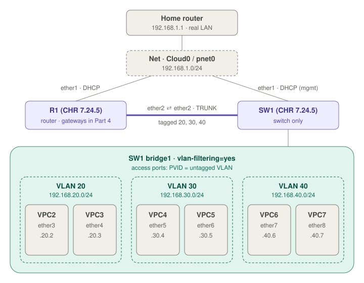

# Lab 2: VLANs

> **Cert:** MTCNA module 3 (Bridging) · MTCRE (VLANs) · **Status:** 🔄 In progress (Part 3 switch VLANs ✅ tested · Part 4 inter-VLAN routing 📝 next)

[Labs index](../README.md) · [Q&A](qa.md) · [Back to the main index](../../README.md)

---

## Goal

A router (R1) and a separate managed switch (SW1). SW1 splits six PCs into three VLANs, two PCs each, so each pair is cut off from the others at Layer 2. One trunk cable carries all three VLANs from SW1 to R1. Later (Part 4), R1 gets a gateway in each VLAN and routes between them.

## Topology



<details><summary>Text version</summary>

```
            Home router (192.168.1.1)
                     │
            Net (Cloud0 / pnet0)  home LAN 192.168.1.0/24
              │                         │
           ether1 (DHCP)             ether1 (DHCP, management only)
          ┌────────┐                ┌────────┐
          │   R1   │ ether2 ══════ ether2 │  SW1   │
          │ router │  TRUNK: tagged 20,30,40 │ switch │
          └────────┘                └────────┘
                                   bridge1, vlan-filtering=yes
                 ┌──────────┬──────────┼──────────┬──────────┬──────────┐
              ether3     ether4     ether5     ether6     ether7     ether8
               VPC2       VPC3       VPC4       VPC5       VPC6       VPC7
              └─ VLAN 20 ──┘        └─ VLAN 30 ──┘        └─ VLAN 40 ──┘
```

</details>

## Concept

| Term | Meaning |
|---|---|
| **VLAN** | Splits one switch into separate Layer 2 networks. Each VLAN is its own broadcast domain |
| **802.1Q tag** | 4-byte label added inside the Ethernet frame, carrying the VLAN ID (1–4094) |
| **Access (untagged) port** | One VLAN, no tag on the cable. For PCs, printers, VPCs |
| **Trunk (tagged) port** | Many VLANs on one cable, tags kept. For switch ↔ switch or switch ↔ router |
| **PVID** | VLAN given to untagged frames coming **in** on a port |
| **Untagged member** | VLAN that leaves the port **out** without a tag |

On an access port, **PVID = untagged VLAN**. MikroTik keeps them as two settings (Cisco's `switchport access vlan` sets both at once), so a mismatch is possible and causes one-way traffic.

**Router-on-a-stick:** R1 is a router only and SW1 is a switch only. MikroTik switch hardware (CRS, SwOS) can't run in EVE-NG, so SW1 is a second CHR used purely as a switch (a bridge with VLAN filtering), which is how a CRS running RouterOS is configured too.

## EVE-NG setup

A new lab file, **`Lab 2 - VLANs`**, with fresh routers. Lab 1 is not touched.

| Item | Value |
|---|---|
| R1 | MikroTik CHR 7.24.5 |
| SW1 | MikroTik CHR 7.24.5, 8 ethernets, used as a switch |
| Upstream | `Net` = Management (Cloud0), home LAN `192.168.1.0/24` |
| Clients | 6 × VPCS, cabled to SW1 |

### Port map

| Device | Port | Connected to | Role / VLAN |
|---|---|---|---|
| R1 | ether1 | Net | Uplink, DHCP client |
| R1 | ether2 | SW1 ether2 | **Trunk** (tagged 20, 30, 40) |
| SW1 | ether1 | Net | **Management** (DHCP client, *not* in the bridge) |
| SW1 | ether2 | R1 ether2 | **Trunk** (tagged 20, 30, 40) |
| SW1 | ether3 | VPC2 | Access VLAN **20** |
| SW1 | ether4 | VPC3 | Access VLAN **20** |
| SW1 | ether5 | VPC4 | Access VLAN **30** |
| SW1 | ether6 | VPC5 | Access VLAN **30** |
| SW1 | ether7 | VPC6 | Access VLAN **40** |
| SW1 | ether8 | VPC7 | Access VLAN **40** |

### Addressing plan

| VLAN | Subnet | Gateway (R1, Part 4) | VPCs |
|---|---|---|---|
| 20 | 192.168.20.0/24 | 192.168.20.1 | VPC2 `.2`, VPC3 `.3` |
| 30 | 192.168.30.0/24 | 192.168.30.1 | VPC4 `.4`, VPC5 `.5` |
| 40 | 192.168.40.0/24 | 192.168.40.1 | VPC6 `.6`, VPC7 `.7` |

The host number matches the VPC number.

> **Out-of-band management:** SW1 ether1 is a separate management port (like a "MGMT" port in a data center). It stays out of bridge1, so a VLAN mistake can never lock you out of WebFig/WinBox.

## Config steps (SW1)

Log in on the console as `admin+ct` (see Troubleshooting).

### 1. Bridge and ports with PVIDs

🖱️ **WebFig/WinBox:** Bridge → Bridge → **+** → Name `bridge1`, VLAN Filtering **unticked** → OK. Then Bridge → Ports → **+** for ether2–ether8, and on each port's **VLAN** section set the PVID.

⌨️ **CLI**
```
/interface bridge add name=bridge1 vlan-filtering=no
/interface bridge port add bridge=bridge1 interface=ether2
/interface bridge port add bridge=bridge1 interface=ether3 pvid=20
/interface bridge port add bridge=bridge1 interface=ether4 pvid=20
/interface bridge port add bridge=bridge1 interface=ether5 pvid=30
/interface bridge port add bridge=bridge1 interface=ether6 pvid=30
/interface bridge port add bridge=bridge1 interface=ether7 pvid=40
/interface bridge port add bridge=bridge1 interface=ether8 pvid=40
```

**Why:** the bridge makes SW1 a switch. The PVID is the "socket color" of each access port. ether1 is left out on purpose (management). ether2 (trunk) keeps PVID 1, because its VLANs arrive tagged. Filtering stays off until the VLAN table is ready.

### 2. VLAN table

🖱️ **WebFig/WinBox:** Bridge → VLANs → **New** → VLAN IDs, Tagged, Untagged → **OK** (not Cancel). Three entries.

⌨️ **CLI**
```
/interface bridge vlan add bridge=bridge1 vlan-ids=20 tagged=ether2 untagged=ether3,ether4
/interface bridge vlan add bridge=bridge1 vlan-ids=30 tagged=ether2 untagged=ether5,ether6
/interface bridge vlan add bridge=bridge1 vlan-ids=40 tagged=ether2 untagged=ether7,ether8
```

**Why:** the PVID decides the VLAN on the way **in**; this table decides which ports each VLAN may go **out** of, tagged (trunk) or untagged (access). Untagged must match the PVIDs.

### 3. Turn VLAN filtering on

🖱️ **WebFig/WinBox:** Bridge → Bridge → `bridge1` → **VLAN** → tick **VLAN Filtering** → OK. Leave EtherType `0x8100` (802.1Q), PVID 1 and Ingress Filtering on.

⌨️ **CLI**
```
/interface bridge set bridge1 vlan-filtering=yes
```

**Why:** until now the bridge ignored PVIDs and the VLAN table (everything was one VLAN 1). Safe here because management runs over ether1, outside the bridge.

### 4. VPC addresses

In each VPCS console (VPCs have no WinBox/WebFig):

| VPC | Command |
|---|---|
| VPC2 | `ip 192.168.20.2/24 192.168.20.1` |
| VPC3 | `ip 192.168.20.3/24 192.168.20.1` |
| VPC4 | `ip 192.168.30.4/24 192.168.30.1` |
| VPC5 | `ip 192.168.30.5/24 192.168.30.1` |
| VPC6 | `ip 192.168.40.6/24 192.168.40.1` |
| VPC7 | `ip 192.168.40.7/24 192.168.40.1` |

Then `save`. Check with `show ip`. The `.1` gateways come to life on R1 in Part 4.

## Verify

```
[admin@SW1] > /interface bridge vlan print
Flags: D - DYNAMIC
Columns: BRIDGE, VLAN-IDS, CURRENT-TAGGED, CURRENT-UNTAGGED
#   BRIDGE   VLAN-IDS  CURRENT-TAGGED  CURRENT-UNTAGGED
0   bridge1        20  ether2          ether3
                                       ether4
1   bridge1        30  ether2          ether5
                                       ether6
2   bridge1        40  ether2          ether8
                                       ether7
;;; added by pvid
3 D bridge1         1                  bridge1
                                       ether2
```

- `CURRENT-*` columns fill in only once VLAN filtering is on. They show what the switch is actually doing.
- The dynamic VLAN 1 row comes from PVID 1 on bridge1 and ether2: VLAN 1 is the **native VLAN** of the trunk (crosses it untagged).
- ✅ Pings between the two VPCs of the same VLAN work (VPC2 ↔ VPC3, VPC4 ↔ VPC5, VPC6 ↔ VPC7).

## Troubleshooting

Real issues from this lab:

| Symptom | Cause | Fix |
|---|---|---|
| R1 console shows junk like `[32mC`, the prompt printed one character per line | RouterOS mis-detects the terminal width/colors over EVE-NG telnet + PuTTY | Log in as `admin+ct` (`c` = no colors, `t` = no terminal detection) |
| `/interface bridge vlan print` is empty after adding VLANs in WebFig | Form closed without **OK** (or Cancel clicked) | Re-add from the CLI, or New → fill → **OK** |
| SW1's DHCP client on the trunk port got `192.168.2.10` from R1 (first build) | CHR ships with a DHCP client on ether1; that port was the trunk | Keep one management port only; remove the client from any port that joins the bridge. Final build moved management to ether1 and the trunk to ether2 |
## Quick check

1. Where is the 802.1Q tag added and removed in this lab: VPC, cable, or switch?
2. Why is ether2 tagged in all three VLANs, while ether3 is untagged in only one?
3. ether3 has `pvid=20` but is untagged in VLAN 30. What happens to VPC2?

Follow-up questions: [qa.md](qa.md)
